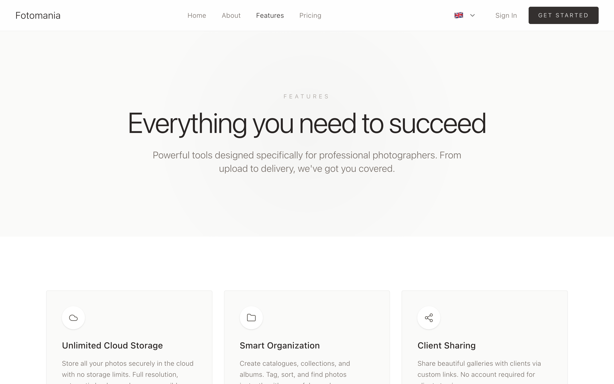

# Fotomania

[](https://github.com/DragarA/fotomania/actions/workflows/ci.yml)
[](./LICENSE)

A full-stack photography gallery and client delivery platform built as a **Turborepo** monorepo with an end-to-end typed pipeline: **Drizzle ORM → NestJS + OpenAPI → autogenerated TypeScript SDK → React + Vite (TanStack Router & Query)**.


<details>
<summary>Features overview screen</summary>



</details>

```text
PostgreSQL + Drizzle ORM ──▶ NestJS API (Passport Auth + Swagger/OpenAPI)
                                     │
                               openapi.json
                                     ▼
                          @repo/sdk (openapi-ts)
                                     │
                                     ▼
               React + Vite Frontend (TanStack Router & Query)
```

### Key Highlights

- **End-to-end type safety** — API DTOs and Swagger decorators generate `openapi.json`, which regenerates `@repo/sdk` for the frontend automatically.
- **Auth & client delivery** — Passport.js (local + Google OAuth) for photographers, password-protected public gallery sessions and favourite selection for clients, plus ZIP export and transactional email templates.
- **Production-ready tooling** — Versioned Drizzle SQL migrations, Jest unit tests with typed mock factories, shared ESLint/Prettier/TypeScript configs, and multi-stage Dockerfiles for API & Web deployment.

## Project Structure

```
fotomania/
├── apps/
│   ├── api/                    # NestJS API with OpenAPI
│   └── web/                    # React + Vite frontend
├── packages/
│   ├── sdk/                    # Autogenerated TypeScript SDK
│   ├── typescript-config/      # Shared TypeScript configurations
│   ├── eslint-config/          # Shared ESLint configurations
│   └── prettier-config/        # Shared Prettier configuration
└── turbo.json                  # Turborepo pipeline configuration
```

## Tech Stack

- **Monorepo**: Turborepo with pnpm workspaces
- **API**: NestJS with @nestjs/swagger for OpenAPI generation
- **Frontend**: React 18 + Vite with TanStack Query and TanStack Router
- **SDK**: Auto-generated from OpenAPI spec using @hey-api/openapi-ts
- **Code Quality**: ESLint + Prettier with shared configurations
- **TypeScript**: Shared tsconfig for consistency across packages

## Prerequisites

- Node.js 24+ (specified in `.nvmrc`)
- pnpm 9+

## Getting Started

### 1. Install Node 24

```bash
nvm use
```

### 2. Install Dependencies

```bash
pnpm install
```

### 3. Development Workflow

The monorepo uses Turborepo to orchestrate tasks across workspaces.

#### First Time Setup:

On your first run, you need to generate the OpenAPI spec:

```bash
# Terminal 1: Start the development servers
pnpm dev

# Terminal 2: Once the API is running (wait ~5 seconds), generate the OpenAPI spec
pnpm --filter @repo/api generate-openapi
```

This creates `apps/api/openapi.json`, which the SDK will automatically use to generate the TypeScript client.

#### Subsequent Development:

Just run:

```bash
pnpm dev
```

This starts:
- API on http://localhost:3000 (with watch mode)
- Web app on http://localhost:5173 (with HMR)
- SDK watcher (auto-regenerates when `openapi.json` changes)

**Note**: The SDK watcher will remind you if the OpenAPI spec doesn't exist yet.

#### Build all packages:

```bash
pnpm build
```

Build order:
1. API builds → compiles TypeScript
2. SDK builds → generates TypeScript client from existing `openapi.json`
3. Web builds → uses the SDK types and functions

#### Lint all code:

```bash
pnpm lint
```

#### Format all code:

```bash
pnpm format
```

## Working with Individual Apps

### API (NestJS)

```bash
# Navigate to API
cd apps/api

# Run in dev mode
pnpm dev

# Build
pnpm build

# View API docs
# http://localhost:3000/api-docs

# View OpenAPI JSON
# http://localhost:3000/api-json
```

The API uses `@nestjs/swagger` decorators to automatically generate OpenAPI specifications from your code.

### Web (React + Vite)

```bash
# Navigate to web app
cd apps/web

# Run in dev mode
pnpm dev

# Build
pnpm build

# Preview production build
pnpm preview
```

The web app uses:
- **TanStack Router** for file-based routing (routes in `src/routes/`)
- **TanStack Query** for server state management
- **@repo/sdk** for type-safe API calls

### SDK Package

The SDK is automatically generated from the API's OpenAPI specification.

```bash
# Navigate to SDK
cd packages/sdk

# Generate SDK manually
pnpm generate

# Watch for changes (auto-regenerate)
pnpm dev
```

**Note**: The SDK requires the API to be built first or running in dev mode to generate the `openapi.json` file.

## How It Works

### OpenAPI → SDK Generation Flow

1. **API Development**: Add NestJS controllers with Swagger decorators
2. **Build/Run API**: Generates `apps/api/openapi.json`
3. **SDK Generation**: `@hey-api/openapi-ts` reads the spec and generates TypeScript client
4. **Frontend Usage**: Import types and functions from `@repo/sdk`

### Development Mode

When running `pnpm dev`:

1. API starts with watch mode on port 3000
2. SDK watcher monitors `apps/api/openapi.json` for changes
3. When API changes → OpenAPI spec updates → SDK regenerates
4. Vite HMR updates the frontend with new SDK types

## Package Scripts

All packages support these scripts (where applicable):

- `dev` - Start in development mode with watch/HMR
- `build` - Build for production
- `lint` - Run ESLint
- `format` - Format code with Prettier

## Turborepo Caching

Turborepo caches build outputs for faster subsequent builds. The cache includes:

- TypeScript compilation outputs (`dist/`, `build/`)
- ESLint results
- Build artifacts

To clear the cache:

```bash
turbo clean
```

## Adding New Features

### Adding API Endpoints

1. Create or update a controller in `apps/api/src/`
2. Add Swagger decorators (`@ApiOperation`, `@ApiResponse`, etc.)
3. The OpenAPI spec will auto-update
4. SDK will regenerate with new types and functions
5. Use the generated SDK in the frontend

Example:

```typescript
// apps/api/src/users/users.controller.ts
@ApiTags('users')
@Controller('users')
export class UsersController {
  @Get()
  @ApiOperation({ summary: 'Get all users' })
  @ApiResponse({ status: 200, type: [User] })
  findAll() {
    return this.usersService.findAll();
  }
}
```

### Adding Frontend Routes

Create a new file in `apps/web/src/routes/`:

```typescript
// apps/web/src/routes/users.tsx
import { createFileRoute } from '@tanstack/react-router';

export const Route = createFileRoute('/users')({
  component: UsersComponent,
});

function UsersComponent() {
  // Use TanStack Query + SDK here
  return <div>Users Page</div>;
}
```

## Shared Configurations

### TypeScript

Shared configs in `packages/typescript-config`:
- `base.json` - Base configuration
- `react.json` - For React apps (extends base)
- `node.json` - For Node apps like NestJS (extends base)

### ESLint

Shared configs in `packages/eslint-config`:
- `base.js` - Base rules with TypeScript support
- `react.js` - React-specific rules (extends base)
- `node.js` - Node-specific rules (extends base)

### Prettier

Single shared config in `packages/prettier-config/index.js`

## Deployment (Railway via Docker)

This repo is deployed to Railway using the Dockerfiles in `apps/api` and `apps/web`.

### API Service

- Build context: repo root
- Dockerfile: `apps/api/Dockerfile`
- Exposed port: `3000`
- Required env vars:
  - `DATABASE_URL`
  - `SESSION_SECRET`
  - `GOOGLE_CLIENT_ID`
  - `GOOGLE_CLIENT_SECRET`

### Web Service

- Build context: repo root
- Dockerfile: `apps/web/Dockerfile`
- Exposed port: `3000` (Railway provides `PORT`)
- Build arg (required at build time):
  - `VITE_API_BASE_URL` (e.g. `https://api.your-domain.com`)

Note: the web Docker build depends on `apps/api/openapi.json`, which is committed in the repo.

## Troubleshooting

### SDK Not Generating

1. Ensure the API is built or running: `cd apps/api && pnpm dev`
2. Verify `apps/api/openapi.json` exists
3. Manually fetch the spec: `curl http://localhost:3000/api-json > apps/api/openapi.json`
4. Run SDK generation: `cd packages/sdk && pnpm generate`

### Type Errors in Frontend

1. Rebuild the SDK: `cd packages/sdk && pnpm build`
2. Restart the dev server: `cd apps/web && pnpm dev`

### Node Version Issues

Ensure you're using Node 24:

```bash
nvm use
node --version  # Should show v24.x.x
```

## License

[MIT](./LICENSE)
