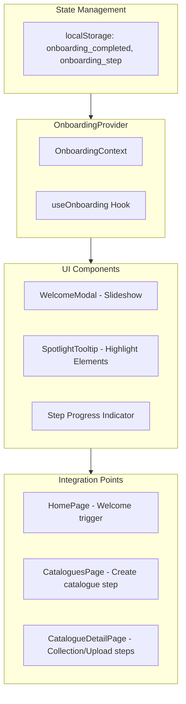

# Onboarding Tutorial Implementation

## Overview

Build a hybrid onboarding system consisting of:

1. **Welcome Modal Slideshow**: Full-screen modal with app introduction slides
2. **Contextual Spotlight Tooltips**: Highlight UI elements as users navigate through the app
3. **Enhanced Home Page**: Add marketing material describing the app

---

## Todos

- [x] Create OnboardingContext and useOnboarding hook with localStorage persistence
- [x] Build WelcomeModal slideshow component with 3 slides
- [x] Build SpotlightTooltip component with overlay and positioning
- [x] Add onboarding namespace translations (en/sl)
- [x] Integrate spotlight into CataloguesPage for create-catalogue step
- [x] Integrate spotlights into GalleryWorkspace for collection/upload/favourites steps
- [x] Add How It Works section and Use Cases (private client vs public event catalogues) to HomePage

---

## Architecture



---

## Implementation Details

### 1. Onboarding State Management

Create a new feature folder at `apps/web/src/features/onboarding/` with:

- **`OnboardingContext.tsx`**: React context to manage tutorial state
  - Track current step (welcome, create-catalogue, explain-ui, create-collection, upload-photos, favourites-delivery)
  - Track completion status per step
  - Persist to localStorage with key `fotomania_onboarding`
  - Expose `startOnboarding()`, `nextStep()`, `skipOnboarding()`, `resetOnboarding()`

- **`useOnboarding.ts`**: Hook for components to access onboarding state

**Status**: Completed. Added `apps/web/src/features/onboarding/OnboardingContext.tsx` and `apps/web/src/features/onboarding/useOnboarding.ts` with localStorage persistence under `fotomania_onboarding`.

### 2. Welcome Modal Component

Create `apps/web/src/features/onboarding/components/WelcomeModal.tsx`:

- Multi-slide carousel inside a Dialog
- **Slide 1**: Welcome screen with app logo and tagline
- **Slide 2**: Brief overview of features (organize photos, share galleries, client favourites)
- **Slide 3**: "Let's get started" with CTA to create first catalogue
- Navigation: dots indicator, next/back buttons, skip button
- On complete: navigate to `/catalogues` and advance to next onboarding step

**Status**: Completed. Added `apps/web/src/features/onboarding/components/WelcomeModal.tsx` with a three-slide flow, dot indicators, and skip/next/get-started actions. The component accepts `onSkip` and `onComplete` callbacks; navigation and onboarding step advancement will be wired during integration.

### 3. Spotlight Tooltip Component

Create `apps/web/src/features/onboarding/components/SpotlightTooltip.tsx`:

- Accepts target element ref or CSS selector
- Renders overlay with cutout around target element
- Positions tooltip adjacent to highlighted area
- Props: `targetRef`, `title`, `description`, `position`, `onNext`, `onSkip`
- Uses Portal to render above all content (z-index management)

**Status**: Completed. Added `apps/web/src/features/onboarding/components/SpotlightTooltip.tsx` with ref/selector targeting, highlight overlay, and positional tooltip rendering.

### 4. Integration Points

**CataloguesPage.tsx** (`apps/web/src/features/gallery/pages/CataloguesPage.tsx`):

- Show spotlight on "Create Catalogue" button when `step === 'create-catalogue'`
- After catalogue created, advance to next step

**Status**: Completed. Added `SpotlightTooltip` integration targeting the primary or empty-state create button and advanced onboarding on successful catalogue creation.

**GalleryWorkspace.tsx** (`apps/web/src/features/gallery/components/workspace/GalleryWorkspace.tsx`):

- Step `explain-ui`: Spotlight on sidebar explaining tabs (Collections/Favourites)
- Step `create-collection`: Spotlight on "Add Collection" button
- Step `upload-photos`: Spotlight on upload button after collection selected
- Step `favourites-delivery`: Spotlight on Favourites tab explaining the flow

**Status**: Completed. Added `SpotlightTooltip` rendering for each step, plus data attributes in `CatalogueSidebar.tsx` and `PhotoWorkspace.tsx` to anchor the highlights.

**CatalogueSidebar.tsx** (`apps/web/src/features/gallery/components/catalogue/CatalogueSidebar.tsx`):

- Add data attributes or refs for spotlight targeting

### 5. Translations

Add new namespace `apps/web/src/i18n/locales/en/onboarding.json` (and `sl/`):

```json
{
  "welcome": {
    "slide1Title": "Welcome to Fotomania",
    "slide1Subtitle": "Your professional photo gallery platform",
    "slide2Title": "Organize & Share",
    "slide2Feature1": "Create beautiful catalogues",
    "slide2Feature2": "Organize photos in collections",
    "slide2Feature3": "Share with clients securely",
    "slide3Title": "Let's Get Started",
    "slide3Subtitle": "Create your first catalogue in seconds"
  },
  "steps": {
    "createCatalogue": "Create your first catalogue",
    "createCatalogueDesc": "Catalogues are containers for your photo shoots. Click here to create one.",
    "explainSidebar": "Your workspace",
    "explainSidebarDesc": "Use Collections to organize photos and Favourites to see client selections.",
    "createCollection": "Add a collection",
    "createCollectionDesc": "Collections help you group related photos. Create one to start uploading.",
    "uploadPhotos": "Upload your photos",
    "uploadPhotosDesc": "Click here or drag and drop images to upload them to this collection.",
    "favouritesDelivery": "Client favourites",
    "favouritesDeliveryDesc": "When clients select favourites from shared catalogues, they appear here. Create delivery collections from selections."
  },
  "buttons": {
    "next": "Next",
    "back": "Back",
    "skip": "Skip Tutorial",
    "getStarted": "Get Started",
    "gotIt": "Got it!"
  }
}
```

**Status**: Completed. Added `apps/web/src/i18n/locales/en/onboarding.json` and `apps/web/src/i18n/locales/sl/onboarding.json`, and wired the `onboarding` namespace in `apps/web/src/i18n/config.ts`.

### 6. Enhanced Home Page Marketing

Update `apps/web/src/features/pages/HomePage.tsx` to add:

- **How It Works Section**: 3-step visual guide
  1. **Create** - Set up your catalogue for a client or event
  2. **Upload & Organize** - Add photos to collections within the catalogue
  3. **Share & Deliver** - Clients pick favourites, you create deliveries instantly

- **Use Cases Section**: Two primary workflows
  - **Private Client Catalogues**: Optimized for 1-on-1 client work (weddings, portraits, studio sessions). Create a catalogue per client, upload their photos, share securely with password protection.
  - **Public Event Catalogues**: Perfect for events with multiple attendees (conferences, parties, sports events). Publish a public catalogue where anyone can browse, select their favourites, and request deliveries - all within the same catalogue. No need to duplicate photos or create separate galleries per person.

- **Key Benefit Highlight**: Emphasize the unified workflow - whether private or public, all favourites and deliveries are managed in one place with zero duplicated work.

- Update existing translations in `common.json` for new content

**Status**: Completed. Added How It Works and Use Cases sections with a benefit highlight to `apps/web/src/features/pages/HomePage.tsx`, and added corresponding copy in `apps/web/src/i18n/locales/en/common.json` and `apps/web/src/i18n/locales/sl/common.json`.

---

## File Changes Summary

| Action | File |
|--------|------|
| Create | `apps/web/src/features/onboarding/OnboardingContext.tsx` |
| Create | `apps/web/src/features/onboarding/useOnboarding.ts` |
| Create | `apps/web/src/features/onboarding/components/WelcomeModal.tsx` |
| Create | `apps/web/src/features/onboarding/components/SpotlightTooltip.tsx` |
| Create | `apps/web/src/features/onboarding/components/index.ts` |
| Create | `apps/web/src/i18n/locales/en/onboarding.json` |
| Create | `apps/web/src/i18n/locales/sl/onboarding.json` |
| Edit | `apps/web/src/i18n/config.ts` - Add onboarding namespace |
| Edit | `apps/web/src/main.tsx` - Wrap with OnboardingProvider |
| Edit | `apps/web/src/features/pages/HomePage.tsx` - Add marketing sections, trigger welcome modal |
| Edit | `apps/web/src/features/gallery/pages/CataloguesPage.tsx` - Add spotlight integration |
| Edit | `apps/web/src/features/gallery/components/workspace/GalleryWorkspace.tsx` - Add spotlight integration |
| Edit | `apps/web/src/features/gallery/components/catalogue/CatalogueSidebar.tsx` - Add data attributes for targeting |
| Edit | `apps/web/src/i18n/locales/en/common.json` - Add home page marketing translations |
| Edit | `apps/web/src/i18n/locales/sl/common.json` - Add home page marketing translations |

---

## Key Design Decisions

1. **localStorage persistence**: Tutorial state persists across sessions so users don't see it again after completion
2. **Step-based progression**: Users can skip at any time, but completing steps unlocks contextual help
3. **Non-blocking**: Spotlights can be dismissed without breaking app functionality
4. **First-time detection**: Welcome modal triggers for authenticated users with no catalogues on first visit to home page or catalogues page

## Progress Update

- `apps/web/src/main.tsx`: Wrapped the app with `OnboardingProvider` so onboarding state is available to all routes.
